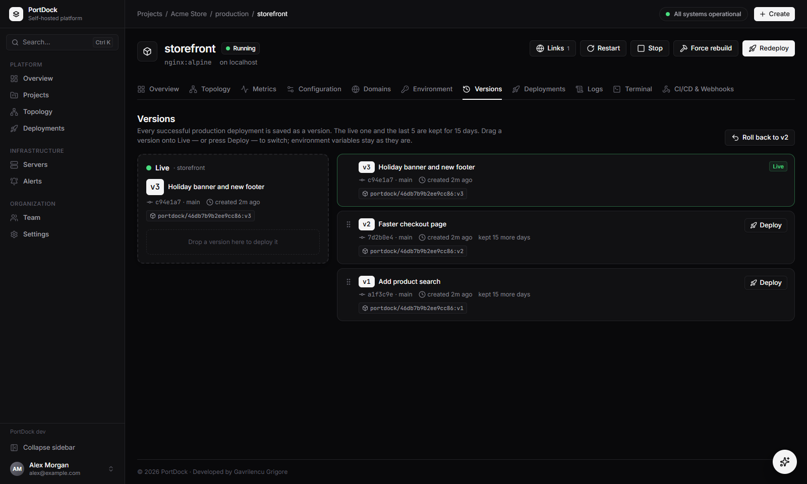
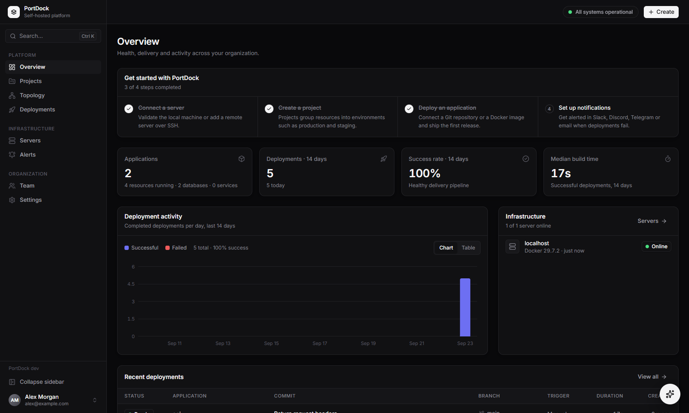
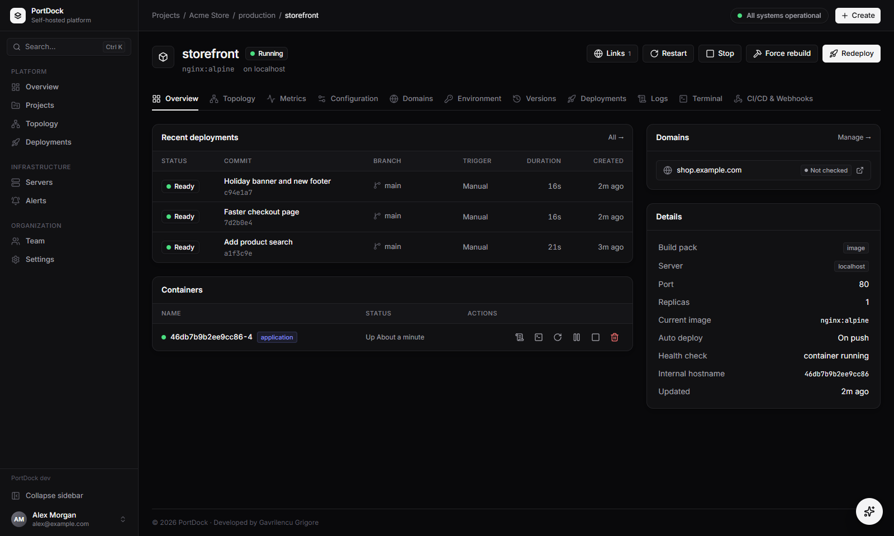
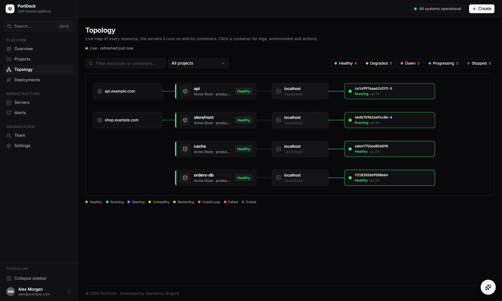
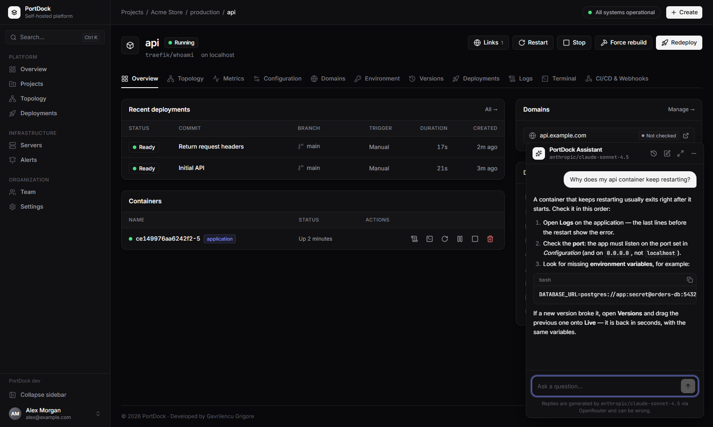
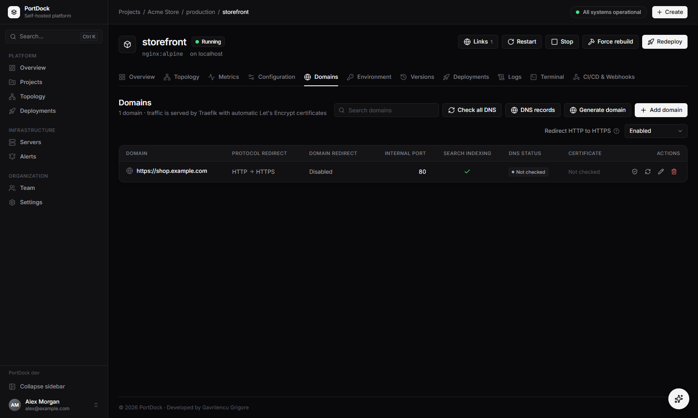
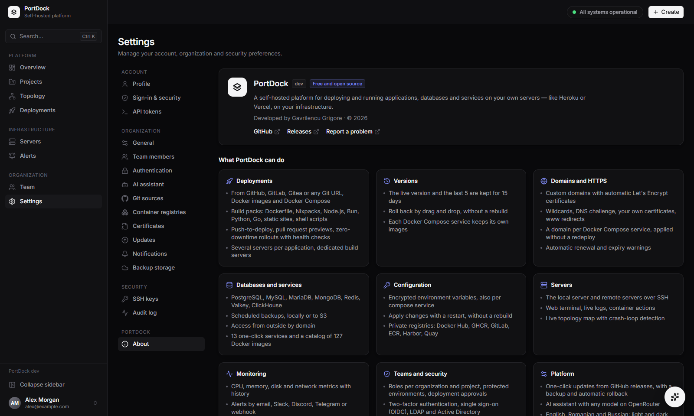

<div align="center">

<picture>
  <source media="(prefers-color-scheme: dark)" srcset="frontend/public/logo-on-dark.png" />
  
</picture>


**Your own Heroku, on your own servers.**
Deploy applications, databases and services from Git or Docker — with HTTPS, rollbacks, monitoring and an AI assistant — on any Linux server you control.

[](https://github.com/gavrilencu/PortDock/releases)
[](LICENSE)
[](https://github.com/gavrilencu/PortDock/pkgs/container/portdock)
[](https://github.com/gavrilencu/PortDock/stargazers)

[Quick start](#quick-start) · [Features](#features) · [Screenshots](#screenshots) · [Documentation](#documentation) · [Română](docs/README.ro.md)



</div>

---

## Why PortDock

- **Everything in one place.** Git deployments, Docker Compose stacks, managed databases, one-click services, domains with automatic HTTPS, metrics, alerts and backups — in a single binary with a modern web interface.
- **Roll back in seconds.** Every production deployment is kept as a version. Drag an older version onto **Live** and it is back — no rebuild, same environment variables.
- **Monorepos done right.** A frontend and a backend in one `docker-compose.yml` deploy together, each service with its own domain and its own variables.
- **Built for teams.** Project roles, protected environments, deployment approvals, SSO (OIDC), LDAP / Active Directory, two-factor authentication and a full audit log.
- **An AI assistant built in.** Ask about failing deployments, DNS or Docker in the corner of every page, with any model on OpenRouter.
- **Free and open source.** No plans, no license keys, no limits on servers or users. Apache-2.0.

## Quick start

On a Linux server (Ubuntu or Debian recommended), as root. Ports **80** and **443** must be free for the HTTPS proxy.

**Option 1 — installer** (installs Docker if it is missing):

```bash
git clone https://github.com/gavrilencu/PortDock.git portdock && cd portdock
sudo bash install.sh                               # dashboard on http://<server-ip>:8000
sudo bash install.sh https://portdock.example.com  # or with a domain that points to the server
```

If port 8000 is taken, the installer picks the next free port and prints the address (or set `PORTDOCK_PORT=9000`).

**Option 2 — prebuilt image** (Docker already installed):

```bash
docker run -d --name portdock --restart unless-stopped \
  -p 8000:8000 \
  -v /var/run/docker.sock:/var/run/docker.sock \
  -v /data/portdock:/data/portdock \
  -e PORTDOCK_PUBLIC_URL=http://<server-ip>:8000 \
  ghcr.io/gavrilencu/portdock:latest
```

Keep the data directory mounted at the same path as on the host (`/data/portdock`): builds and backups are bind-mounted into helper containers by absolute path.

**Then:** open the dashboard, create the owner account, and start the proxy from **Servers → localhost → Run setup**. Every [release](https://github.com/gavrilencu/PortDock/releases) lists the exact commands for that version.

## Features

<table>
<tr>
<td width="50%" valign="top">

**🚀 Deployments**
- From GitHub (GitHub App), Azure DevOps, GitLab, Gitea / Forgejo, Bitbucket or any Git URL; Docker images; Docker Compose
- Build packs: Dockerfile, Nixpacks, Node.js, Bun, Python, Go, static sites, shell scripts — auto-detected
- Push-to-deploy, pull request previews with their own domain, deploy hooks for any CI
- Deployment status on commits and pull requests (GitHub, Azure DevOps)
- Zero-downtime rollouts: traffic moves only after the health check passes
- Pre- and post-deploy commands, replicas, CPU / memory limits, watch paths for monorepos
- Several servers per application, dedicated build servers, private registries

</td>
<td width="50%" valign="top">

**🕘 Versions**
- Every production deployment becomes a version (v1, v2…)
- The live version and the last 5 are kept for 15 days
- Roll back by drag and drop or in two clicks — no rebuild, current variables
- Docker Compose services each keep their own images

**🌐 Domains & HTTPS**
- Automatic Let's Encrypt certificates, renewal and expiry watchdog
- Wildcards, DNS-01 (Cloudflare, Route 53, Azure, Hetzner…), uploaded certificates
- www redirects, per-domain ports and paths, a domain per compose service
- Changes apply in seconds, without a redeploy

</td>
</tr>
<tr>
<td valign="top">

**🗄️ Databases & services**
- PostgreSQL, MySQL, MariaDB, Microsoft SQL Server, MongoDB, Redis, Valkey, ClickHouse
- Online backups for every engine, following each one's documentation; manual, scheduled or all at once, queued per database, downloadable
- Restore in one click, after an automatic safety backup; retention, upload to S3 (AWS, R2, B2, MinIO)
- Access from outside by domain or public IP
- SQL console in the browser (PostgreSQL, MySQL, MariaDB, SQL Server, ClickHouse): tables, results, CSV export; read-only for members
- 13 one-click services (n8n, WordPress, Gitea, Grafana, Vaultwarden, MinIO…) and a catalog of 127 Docker images

**⚙️ Configuration**
- Encrypted environment variables (AES-256-GCM), build-time and runtime, per compose service
- Variables from `docker-compose.yml` shown and overridable; apply with a restart
- Registries: Docker Hub, GHCR, GitLab, Amazon ECR, Harbor, Quay, any OCI registry
- Corporate networks: HTTP(S) proxy for PortDock, builds and containers (NO_PROXY with domains and CIDRs), Docker Hub mirror (Nexus, Artifactory, Harbor) applied to each server's daemon, npm / PyPI / Go / Maven mirrors for builds

</td>
<td valign="top">

**🖥️ Servers & containers**
- The local server and remote servers over SSH (keys encrypted, host key pinning)
- One-click server setup: Docker, network and the Traefik proxy
- Web terminal, live logs, start / stop / restart, images, volumes, networks, prune
- One view of the containers, images and volumes of every server, with CPU / memory and the resource each belongs to
- Live topology map with crash-loop detection, in the style of Argo CD

**📈 Monitoring & alerts**
- CPU, memory, disk, network and load history for servers and every resource
- Alert rules with duration and severity; notifications by email, Slack, Microsoft Teams, Discord, Telegram or signed webhook
- Uptime monitors (status code, keyword, response time, TLS expiry) with incidents and a public status page

</td>
</tr>
<tr>
<td valign="top">

**🔐 Teams & security**
- Owner / admin / member, plus viewer / developer / maintainer roles per project
- Protected environments and deployment approvals (four-eyes principle)
- Two-factor authentication with recovery codes, organization-wide 2FA policy
- Single sign-on (OIDC: Entra ID, Okta, Google, Keycloak, Authentik…) and LDAP / Active Directory
- Audit log with CSV / JSON export and SIEM streaming (webhook or syslog), API tokens
- Vulnerability scanning of images with Trivy, optionally blocking deployments on critical or high findings
- Static analysis of the source with Semgrep (SAST) and dynamic scans of the running app with OWASP ZAP (DAST), on every deploy or on demand
- Downloadable reports for every scan (HTML, CSV, JSON, SARIF, ZAP) and a ZIP with all the reports of a deployment

</td>
<td valign="top">

**✨ Platform**
- One-click updates from GitHub releases, with a backup and automatic rollback
- AI assistant with any model on OpenRouter, per-user history, access control
- Interface in English, Romanian and Russian; light and dark theme
- Command palette (Ctrl K), real-time UI, full-width responsive layout

</td>
</tr>
</table>

## Screenshots

| | |
|---|---|
|  **Dashboard** — every project, deployment and server at a glance |  **Application** — deployments, containers, domains and details |
|  **Topology** — domains, resources, servers and containers, live |  **AI assistant** — help with deployments, right where you work |
|  **Domains** — HTTPS, redirects and DNS checks per domain |  **About** — everything PortDock can do |

## PortDock vs. a hosted PaaS

| | Hosted PaaS (Heroku, Vercel, Render…) | PortDock |
|---|---|---|
| Where your apps and data live | The provider's cloud | Your own servers, any provider or on-premises |
| Cost | Per app, per seat, per GB | Free — you pay only for your servers |
| Limits | Plan limits on apps, builds, bandwidth | None |
| Databases | Paid add-ons | Included, with backups to your own S3 |
| Single sign-on, LDAP, audit log | Usually enterprise plans | Included |
| Vendor lock-in | Provider-specific configuration | Standard Docker and Docker Compose |

If you know Coolify, Dokploy or CapRover, PortDock will feel familiar — with versions and drag-and-drop rollback, a domain and variables per compose service, deployment approvals, SSO / LDAP and an AI assistant included.

## Documentation

<details>
<summary><b>Remote servers</b></summary>

1. **Servers → Add server** and generate an SSH key.
2. Add the public key to `~/.ssh/authorized_keys` on the server (the `root` user is recommended).
3. Press **Run setup** on the new server: it installs Docker, the `portdock` network and the Traefik proxy.
4. Optional: set a *wildcard domain* (`*.apps.example.com` → server IP) for automatic domains and previews.

</details>

<details>
<summary><b>Domains and certificates</b></summary>

- Each application has a **Domains** tab: HTTP → HTTPS redirect, www redirect, internal port per domain, search indexing (`X-Robots-Tag`), DNS status and certificate status. Changes reach the proxy within seconds, without a redeploy.
- **Check all DNS** compares A / AAAA records with the server IP and detects the Cloudflare proxy; **DNS records** lists exactly what to create.
- Let's Encrypt certificates are issued and renewed automatically. A watchdog checks them every 6 hours and forces a renewal when fewer than 14 days are left, with notifications (`certificate.expiring`, `certificate.renewed`, `certificate.failed`).
- **DNS-01** for wildcard and internal domains: Cloudflare, Route 53, Azure DNS, Google Cloud DNS, DigitalOcean, Hetzner, OVH, GoDaddy, RFC 2136 or any provider supported by lego. A custom ACME server (step-ca) or the Let's Encrypt staging environment can be used too.
- **Uploaded certificates** (corporate CA, EV / OV) are validated and distributed to every proxy, with reminders before they expire.
- **Settings → General** sets the dashboard URL (PortDock serves itself on that domain with a certificate), time zone and public IPs.

</details>

<details>
<summary><b>Docker Compose: a domain and variables per service</b></summary>

- When the repository comes from GitHub, PortDock reads `docker-compose.yml` and offers a domain field for every service at creation — for example `app.example.com` → `frontend` and `api.example.com` → `backend`. The port is taken from `ports` / `expose`.
- Later, the **Domains** tab has a *Service* selector; changes apply without a redeploy.
- The **Environment** tab has variables for the whole application (available as `${VAR}` in the compose file) and variables per service, which override the values in `docker-compose.yml`. **Restart with new variables** applies them without a rebuild.
- Prefer `expose:` over `ports:` so containers don't bind ports on the host — traffic comes through the proxy.

</details>

<details>
<summary><b>Versions and rollbacks</b></summary>

- Every successful production deployment is saved as a numbered version. Single-container applications tag their image; compose applications tag the image of every built service and keep the compose file.
- The live version plus the last 5 are kept for 15 days; older ones are removed automatically.
- In the **Versions** tab, drag a version onto **Live**, press **Deploy** or **Roll back to vN**. Nothing is rebuilt, the current variables are used, and the old version stops only once the new one is healthy. Approvals apply when the environment requires them.

</details>

<details>
<summary><b>Database backups</b></summary>

- **Back up now**, a **schedule** (cron, keeps its last N files, optional S3 upload) or **Settings → Backup storage → Back up all now**.
- Backups and restores of a database run one at a time: new requests wait as **Pending**; at most two jobs run per server.
- Files are stored on the database's server in `/data/portdock/backups/<database>/`; the Backups tab shows the path and downloads them.
- **Restore** first takes a safety backup of the current data (kept as *Before restore*), then replaces the data; if the safety backup fails, nothing is restored.

| Engine | Backup | Restore |
|---|---|---|
| PostgreSQL | `pg_dump` custom format | `pg_restore --clean --if-exists` in a single transaction |
| MySQL / MariaDB | `mysqldump` / `mariadb-dump --single-transaction` with routines, events and triggers | `mysql` / `mariadb` |
| Microsoft SQL Server | copy-only full backup `WITH CHECKSUM`, checked with `RESTORE VERIFYONLY` | `RESTORE … WITH REPLACE` (sessions closed with `SINGLE_USER`, reopened afterwards) |
| MongoDB | `mongodump --archive --gzip` | `mongorestore --drop` |
| ClickHouse | table schemas and data in Native format | tables recreated and reloaded, then views |
| Redis / Valkey | `BGSAVE` (doesn't block clients) → RDB file | download only |

SQL Server runs the free **Express** edition (`MSSQL_PID`); it needs about 2 GB of memory.

</details>

<details>
<summary><b>GitHub integration</b></summary>

1. **Settings → Git sources → Connect GitHub.** PortDock creates a private GitHub App with minimal permissions (Contents, Metadata and Pull requests read; Commit statuses write), optionally under an organization or on GitHub Enterprise Server. **Use existing app** takes an App ID, private key and webhook secret.
2. Install the app on your account or organization and choose the repositories.
3. **New resource → Git repository → GitHub**: pick the repository and branch; the build pack is detected automatically.
4. Every push deploys; pull requests get previews if enabled. The status appears on the commit as `portdock/deploy`.

GitHub needs a public HTTPS `PORTDOCK_PUBLIC_URL` to deliver webhooks.

</details>

<details>
<summary><b>Azure DevOps integration</b></summary>

1. In Azure DevOps create a **personal access token** (*User settings → Personal access tokens*) for the organization with the scopes **Code: Read, Status** and **Service Hooks: Read, query & manage**. To add service hooks, the token's user must be allowed to edit subscriptions in the project (project administrators are).
2. **Settings → Git sources → Connect Azure DevOps**: enter the organization (`contoso`, `https://dev.azure.com/contoso`, `https://contoso.visualstudio.com`, or the collection URL of Azure DevOps Server 2020+) and the token. PortDock checks it by listing the repositories and stores it encrypted.
3. **New resource → Git repository → Azure DevOps**: pick the repository and branch; the build pack is detected from the repository, like for GitHub.
4. PortDock clones with the token and adds **service hooks** (*Code pushed*, *Pull request created*, *Pull request updated* → Web Hooks) to the repository, authenticated by a secret HTTP header. Every push to the branch deploys; watch paths are checked against the files of the pushed commits. The hooks are replaced when the webhook secret is regenerated and removed when the application is deleted.
5. With previews enabled, every active pull request targeting the branch gets a **preview deployment** with its own domain, redeployed on new commits (not on votes or title changes) and removed when the pull request is completed or abandoned.
6. Each deployment is reported as **`portdock/deploy`** on the commit, and as **`portdock/preview`** on the pull request, linking to the deployment in PortDock.

*CI/CD & Webhooks* shows the state of the hooks, recreates them, and gives the URL and header to add it by hand if the token can't. Tokens expire: replace them from *Settings → Git sources* without touching the applications. Azure DevOps needs a public HTTPS `PORTDOCK_PUBLIC_URL` to deliver events.

</details>

<details>
<summary><b>Corporate proxy and Nexus</b></summary>

*Settings → Network & proxy*:

- **Corporate proxy** — HTTP / HTTPS proxy, optional user and password (stored encrypted), and `NO_PROXY` (names, `.domains`, IPs, CIDR ranges). Choose where it is used:
  - **PortDock itself**: Git providers, update checks, notifications, the AI assistant, uptime checks.
  - **Builds**: git clone, `docker build` (as predefined build arguments, so it is not stored in the image), Nixpacks, Docker Compose builds, the Trivy database.
  - **Containers**: `HTTP_PROXY`, `HTTPS_PROXY` and `NO_PROXY` in every application and service. Each application can follow the setting, always use the proxy or never use it (*Configuration → Network*).
  - *Test* checks a URL through the settings being edited, before saving them.
- **Docker Hub mirror** — a pull-through registry (a Nexus *docker (proxy)* repository, Artifactory, Harbor). PortDock merges it into `/etc/docker/daemon.json` on each server (other keys are kept, `insecure-registries` for plain HTTP) and reloads Docker without stopping containers. The daemon's own proxy is written as a systemd drop-in and needs a restart of Docker, offered with a confirmation.
- **Package mirrors** — npm, PyPI, Go proxy and any other build variable (Maven, NuGet…). The Node.js, Bun, Python and Go build packs use them automatically; in your own Dockerfile declare `ARG NPM_CONFIG_REGISTRY` (etc.). A mirror of the Trivy database can be set for servers without internet.

Private images hosted in Nexus are added in *Container registries* like any registry.

</details>

<details>
<summary><b>CI/CD</b></summary>

**Push-to-deploy:** in the application, *CI/CD & Webhooks* shows the GitHub / GitLab / Gitea webhook URL and secret (events: push and pull request).

**Tests before deploying** (GitHub Actions) — turn off *Deploy on push* and trigger the deployment after the tests:

```yaml
- run: npm ci && npm test
- run: curl -fsS -X POST "${{ secrets.PORTDOCK_DEPLOY_HOOK }}&commit=${{ github.sha }}"
```

**API:** `curl -X POST $URL/api/applications/<id>/deploy -H "Authorization: Bearer pd_…"`

</details>

<details>
<summary><b>Single sign-on and LDAP / Active Directory</b></summary>

**SSO (OpenID Connect):** **Settings → Authentication → Add provider**, copy the *Redirect URI* (`<dashboard URL>/api/auth/sso/<slug>/callback`) into the app at your identity provider, then fill in the issuer URL, client ID and secret. PKCE, ID token signatures, nonce, audience and expiry are verified. Accounts can be created on first sign-in, restricted to email domains, and admin rights mapped from groups. Password sign-in can be turned off (the owner keeps a break-glass account). Existing accounts are linked by e-mail only for members with a verified e-mail; owners and administrators connect a provider themselves from **Settings → Profile**, and administrators link local accounts to an LDAP directory from **Settings → Team**.

- Entra ID: `https://login.microsoftonline.com/<tenant-id>/v2.0` (add the optional `groups` claim for admin mapping)
- Okta: `https://<org>.okta.com` with the `groups` scope
- Keycloak: `https://<host>/realms/<realm>`

**LDAP / Active Directory:** presets for Active Directory, OpenLDAP and FreeIPA; LDAPS or StartTLS with an optional custom CA; a service account finds the user and the password is checked with a bind; disabled AD accounts are refused and nested groups resolved; required groups and admin groups can be set. **Test** shows the email, groups and resulting role of a user.

</details>

<details>
<summary><b>AI assistant</b></summary>

**Settings → AI assistant** turns on a chat assistant in the bottom-right corner:

- any model on [OpenRouter](https://openrouter.ai), picked from the full catalog (search, context, price per 1M tokens, free-models filter) or typed by id, e.g. `anthropic/claude-sonnet-4.5`;
- the API key is stored encrypted; **Test connection** checks the key and the model;
- access for all users, administrators only or selected users; optional instructions for the system prompt;
- each user has a private history; replies stream in with Markdown, code blocks, Stop and copy.

Messages are sent to OpenRouter and the provider of the selected model — don't paste secrets. `PORTDOCK_OPENROUTER_URL` points the assistant at an OpenRouter-compatible gateway.

</details>

<details>
<summary><b>Updates</b></summary>

Pushing a `vX.Y.Z` tag runs `.github/workflows/release.yml`: tests, the multi-arch image `ghcr.io/<owner>/<repo>:vX.Y.Z` and the GitHub release, whose description comes from `docs/releases/vX.Y.Z.md` plus install instructions. Every build knows its repository, so installations find updates without configuration. PortDock checks for a new release whenever it is opened and shows **Update available** in the sidebar.

On update, PortDock refuses to start while deployments are running, downloads the image, backs up the database and encryption key to `/data/portdock/backups/portdock/`, then an updater container recreates PortDock with the same configuration and waits for its health check — rolling back automatically if the new version doesn't start. Applications keep running throughout. Automatic updates between 02:00 and 05:00 can be enabled for stable releases.

</details>

<details>
<summary><b>Recovery from the command line</b></summary>

```bash
docker exec portdock portdock -reset-password admin@example.com   # new password for a user
docker exec portdock portdock -disable-2fa user@example.com       # turn off two-factor authentication
```

</details>

## Configuration

| Variable | Default | Description |
|---|---|---|
| `PORTDOCK_ADDR` | `:8000` | HTTP listen address |
| `PORTDOCK_PORT` | `8000` | Host port used by `install.sh` / `docker-compose.yml` |
| `PORTDOCK_DATA_DIR` | `/data/portdock` | Database, encryption key, builds and backups. In Docker, mount it at the same path as on the host. |
| `PORTDOCK_PUBLIC_URL` | `http://localhost:8000` | External URL (webhooks); `https://` enables secure cookies |
| `PORTDOCK_SECRET_KEY` | generated in `secret.key` | AES key for secrets (base64, 32 bytes, or a passphrase). **Back it up.** |
| `PORTDOCK_MAX_BUILDS` | `4` | Parallel deployments |
| `PORTDOCK_NETWORK` | `portdock` | Docker network shared with Traefik |
| `PORTDOCK_OPENROUTER_URL` | `https://openrouter.ai/api/v1` | API used by the AI assistant |
| `PORTDOCK_TRUSTED_PROXIES` | private ranges | Proxies whose `X-Forwarded-For` is trusted for client addresses (sign-in limits, audit log): IPs or CIDR ranges, or `none` |
| `PORTDOCK_DEV` / `PORTDOCK_DEBUG` | – | CORS for development / debug logs |

Behind Docker Hub rate limits, build through a mirror: `BASE_REGISTRY=mirror.gcr.io/library docker compose build`.

## Development

```bash
make dev-api   # backend on :8000, data in ./.data
make dev-ui    # Vite on :5173, proxying /api to :8000
make test      # go vet, go test and the TypeScript check
make build     # bin/portdock with the UI embedded
```

The backend runs Docker commands through a shell; on Windows use Git Bash or WSL with Docker Desktop, or run everything with `docker compose up --build`. New interface texts go through `t("…")` with translations in `frontend/src/locales/`; `npm run i18n:check` lists missing ones.

### Stack

| Layer | Technologies |
|---|---|
| Backend | Go, `net/http`, SQLite (pure-Go driver, WAL), `x/crypto/ssh`, WebSocket, SSE |
| Frontend | React 19, Vite, TypeScript, Tailwind CSS 4, TanStack Query, React Router, xterm.js |
| Runtime | Docker and Docker Compose, Traefik v3 (reverse proxy, Let's Encrypt, HTTP/3) |

### Architecture

```
backend/
  cmd/portdock          entrypoint: HTTP server, deploy workers, monitor, scheduler
  internal/api          REST, SSE (logs, events, chat), WebSocket (terminal), webhooks, embedded UI
  internal/deploy       queue and pipeline (clone → build → health check → rollout), compose,
                        versions, databases, backups, services, certificates, routes
  internal/executor     local / SSH command execution (pool, PTY, host key pinning)
  internal/docker       Docker CLI wrapper
  internal/proxy        Traefik: proxy container, file-provider routes, TLS
  internal/assistant    OpenRouter client for the AI assistant
  internal/github       GitHub App client and build pack detection
  internal/azuredevops  Azure DevOps REST client (repositories, files, service hooks)
  internal/updater      self-update from GitHub releases
  internal/store        SQLite schema, migrations and mapper
  internal/{auth,secrets,notify,scheduler,monitor,ldapauth,sso,registry,templates,…}
frontend/src
  pages/ components/ lib/ locales/
```

Every server operation goes through an `Executor` (local or SSH) and the Docker CLI, so local and remote servers behave the same. Routing is written as Traefik file-provider configuration, which is why domain changes apply instantly.

### Known limitations

- Databases and one-click services run on a single server. Applications can run on several servers; balance traffic between them with DNS or an external load balancer.
- Pull request previews run on the primary server only.
- No Docker Swarm or Kubernetes.
- Git over SSH (`git@…`) isn't supported — use HTTPS with a token, or the GitHub App.
- Database backups are logical dumps, not volume snapshots.

## Contributing

Issues and pull requests are welcome — see [CONTRIBUTING.md](CONTRIBUTING.md). To report a security problem privately, see [SECURITY.md](SECURITY.md).

If PortDock is useful to you, a ⭐ on GitHub helps others find it.

## License

PortDock is free and open source under the [Apache License 2.0](LICENSE). See [NOTICE](NOTICE).

Developed by **Gavrilencu Grigore**.
